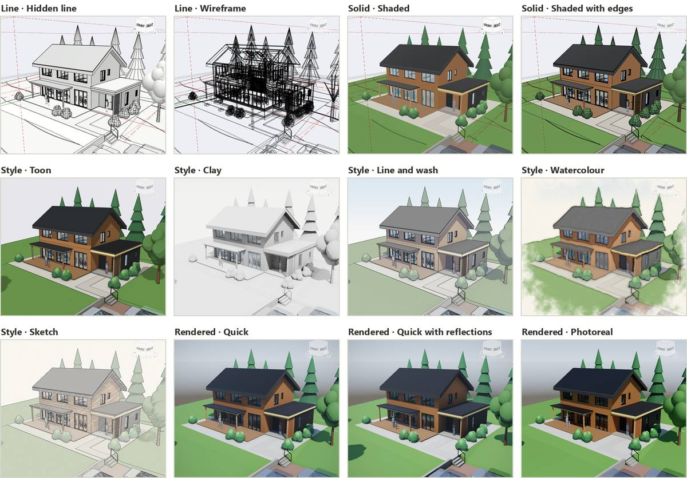
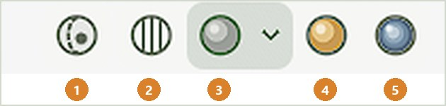
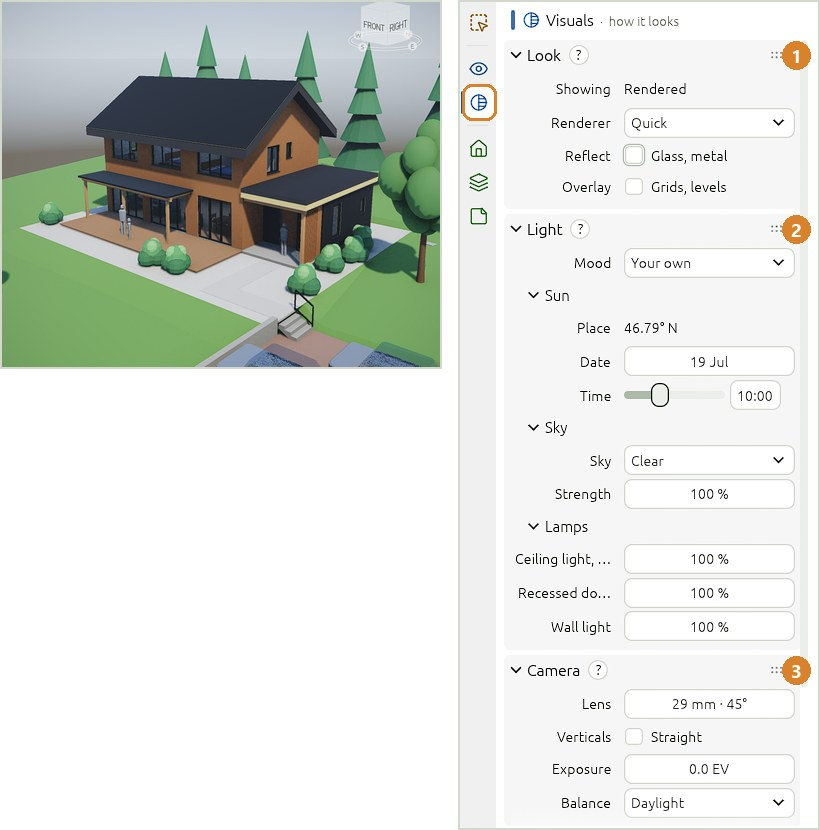
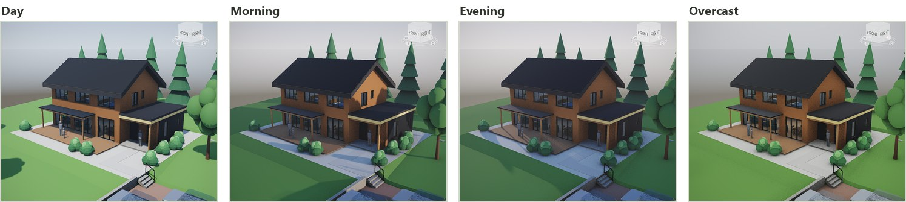

# Render and light

The 3D view can show the model as lines, as shaded surfaces, in a drawing style, or rendered with the sun, the sky and the model's own lamps. You pick the look with the buttons in the 3D view's header; everything else about how it looks is in the **Visuals** tab of *Properties*.

## The display buttons

| | Button | What it shows |
| --- | --- | --- |
| 1 | **X-ray** | See through walls and slabs, in the Line and Solid looks |
| 2 | **Line** | Edges only: *Hidden line* (white surfaces and their visible edges, like a drawing) or *Wireframe* (every edge, the hidden ones too) |
| 3 | **Solid** | Shaded surfaces in their materials' colours: *Shaded* or *Shaded with edges* |
| 4 | **Style** | A drawing style: *Toon*, *Clay*, *Line and wash*, *Watercolour* or *Sketch* |
| 5 | **Rendered** | Lit by the sun and the sky: *Quick*, *Quick with reflections* or *Photoreal* |

Each button shows the look of its kind you used last. The small arrow beside the lit button lists its looks, so *Hidden line* and *Wireframe* are one click apart.

A Style or Rendered look is made while the view is still: move the view and it shows shaded, stop and the picture comes back, a rough one first and then the full one. *Photoreal* bounces real light and gets cleaner pass by pass, the longer the view stays still. Grids, levels and dimensions are left off a Style or Rendered look; *Overlay* puts them back.

## The Visuals tab

Open it from its icon on the tab rail, with the 3D view in front.

1. **Look**: *Showing* names the lit display button; the rows under it are that button's (below).
2. **Light**: the mood, the sun, the sky and the lamps.
3. **Camera**: lens, verticals, exposure and white balance.

Further down, **Output** keeps a render.

### Look

- **Hidden** (Line): *Hide the back* gives hidden line; off, wireframe.
- **Edges** (Solid): *Drawn over* draws every edge over the shaded surfaces.
- **Style**: the drawing style the *Style* button shows.
- **Renderer**: *Quick* (sun and sky, soft shadows, darker corners) or *Photoreal* (real light, bounced). **Reflect** › *Glass, metal* makes them reflect the scene in Quick.
- **Overlay** › *Grids, levels*: grid bubbles, levels and dimensions over a Style or Rendered look. Saved images leave them out.

### Light

- **Mood** sets a moment of light in one go: *Day*, *Morning*, *Evening*, *Overcast* or *Night*. It sets the time, the sky and the exposure; change any of them and the mood becomes *Your own*.
- **Sun**: the *Place* is the project's latitude and true north, set in *Manage › Project information* (Paris until you set one). Drag *Date* and *Time* to move the sun; the time is solar time at that place.
- **Sky**: *Clear* (a strong sun, sharp shadows), *Hazy* (a weaker sun, softer shadows) or *Overcast* (grey light from everywhere, no hard shadows). *Strength* is how much the sky lights the shade and the rooms inside; the sun is not changed.
- **Lamps**: the model's light fittings light the Rendered looks. Each group of fittings has a strength here, and 0 turns it off. What one fitting gives (its output, colour, beam and group) is on the fitting: select it and look in *Properties*. The *Night* mood needs light fittings in the model; place one from *Model › Objects › Lighting*.

The sun and the sky light the Style and Rendered looks; lamps light the Rendered ones.

### Camera

| Row | What it does |
| --- | --- |
| **Lens** | in millimetres, as on a full-frame camera: 18 to 24 mm for rooms, 28 to 35 mm for a house from the street, 50 mm and up for a long view. A parallel view has no lens; switch the view to perspective for one |
| **Verticals** › *Straight* | keeps the edges of walls upright, as an architect's shift lens does, where a tilted camera would make them lean. It doesn't apply when you look steeply up or down |
| **Exposure** | in stops: about 0 outdoors, +3 inside by day, +7 by lamplight |
| **Balance** | the white balance: *Daylight*, *Cloudy*, *Warm* or *Lamplight*. With *Lamplight*, a room at night reads white instead of orange. It changes the colour, not the brightness |

## Output: keeping a render

- **Size**: *As the 3D view*, or a set size: *Wide 1920 × 1080*, *Tall 1080 × 1920*, *Square 1080 × 1080*, *Portrait 1080 × 1350*, *Banner 2560 × 1440* or *Sheet 3508 × 2480*. Another shape than the view's shows more or less at the sides.
- **Render and keep** renders the view at that size in the background and keeps it in the project. While it works, *Making* shows its progress and **Stop** drops it. When the size is *As the 3D view*, the button is **Keep as a render**: it keeps the picture already on screen.
- **Save image…** saves the view as it is rendered now as a PNG, wherever you choose.

## Renders

A kept render is a picture in a **Renders** folder beside the project file, listed in the *Renders* group of the project browser. The group's **+** keeps the 3D view as it is rendered now. Click a render to open it in a **Render** view, as you would a plan or a sheet; *Properties* then shows its **Render** tab.

- Zoom with the steps or the wheel, drag to pan, double-click to fit it. One button shows it at its real size, one pixel to a pixel.
- **Crop…** frames part of it, *Free* or at a set shape (*Wide 16:9*, *Tall 9:16*, *Square*, *Portrait 4:5*, *Banner*, *Sheet*). *Keep the crop* saves what is inside as a new render; the first one stays as it was.
- **Pick colours** reads a colour off the picture: the *Pointer* row shows the colour under the pointer, and a click keeps it in the list and copies its code.
- **Add an image** brings in a PNG or JPEG made elsewhere (a photo, a reference, a render from another program). It is copied into the project's Renders.
- Each render keeps the look, light and view it was made with. **Back to its view** puts the 3D view back where it was, to render it again.

See also [Navigate the 3D view](navigate) and [Graphic styles](graphic-styles).
