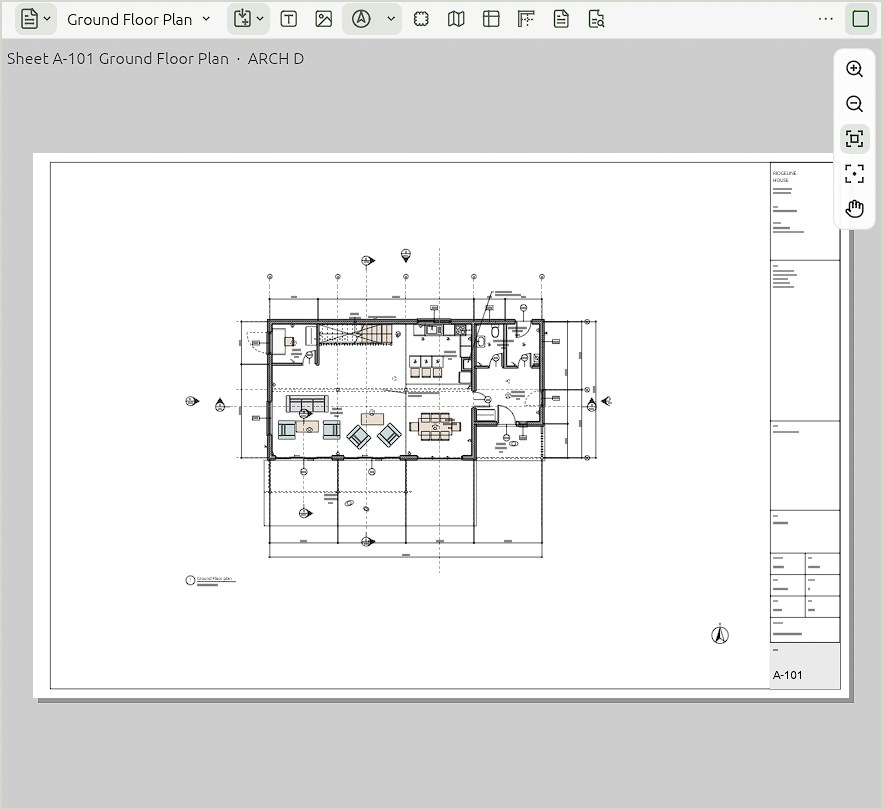
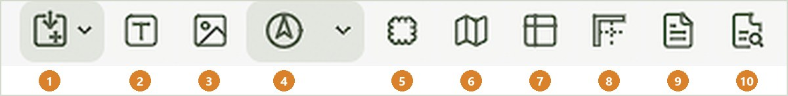
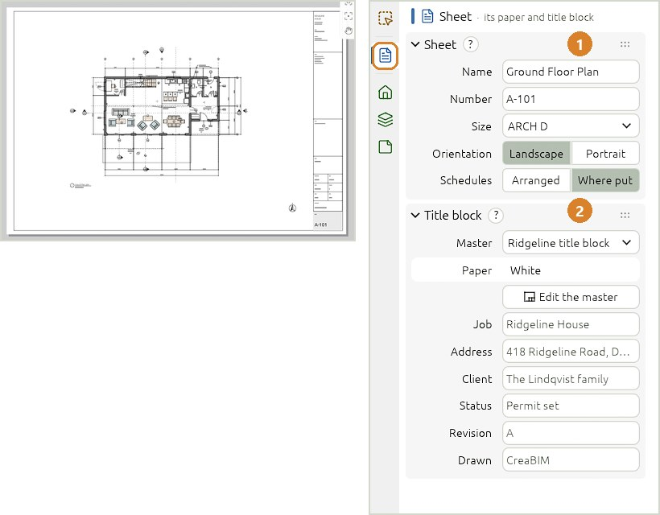
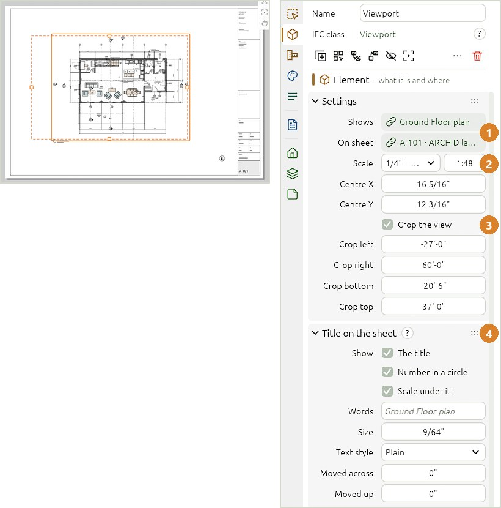
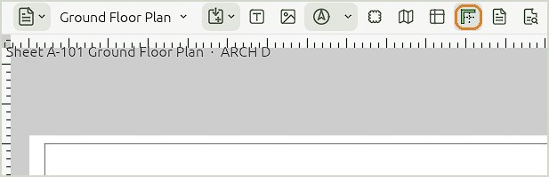
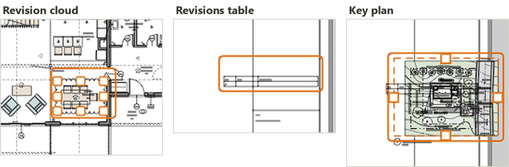
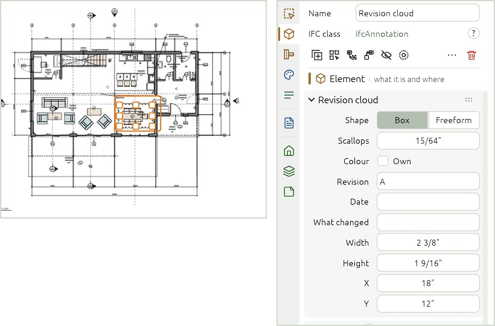
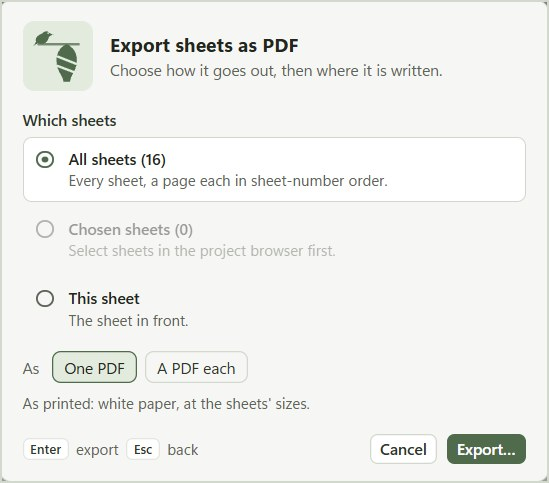

# Sheets and title blocks

A **sheet** is a page for printing, from A0 to A4, with a title block. Views placed on it are drawn from the current model, so they are never out of date.

## Making a sheet

*File › New sheet*, or **New sheet** on the *View* tab. Open a sheet from the browser's *Sheets* group, or in any [area](interface#view-areas) from its view-type menu. The *Sheets* and *Document* [workspaces](interface#workspaces) put a sheet beside the drawing you are placing on it. `PageUp` and `PageDown` step through the sheets.

The area's header names the sheet and its size ("Sheet A-101 Ground Floor Plan · ARCH D").

## The sheet's header

| | Button | Does |
| --- | --- | --- |
| 1 | **Place view…** | puts a view on the sheet (below) |
| 2 | **Text** | text on the sheet: click where it goes (`N`) |
| 3 | **Picture** | a photo, a render, a logo or a stamp |
| 4 | **North arrow** / **Scale bar** | one split button: it places the one used last; its arrow lists both |
| 5 | **Revision cloud** | a cloud round what changed |
| 6 | **Key plan** | the whole floor, small, over the title block |
| 7 | **Revisions table** | a row for each revision cloud on the sheet |
| 8 | **Guides** | rulers and guides, on or off |
| 9 | **Sheet as PDF** | this sheet as a PDF (`Ctrl+P`) |
| 10 | **Print preview** | the sheet as it prints, on white |

## The Sheet tab

Click empty paper on a sheet, with nothing on it picked, and *Properties* shows its **Sheet** tab.

1. **Sheet**
   - **Name** and **Number**.
   - **Size**, from the project's drawing standard (A0 to A4, or ARCH and ANSI sheets in a US project; the others under *Show all*). A new sheet takes its master's size.
   - **Orientation**, *Landscape* or *Portrait*: the same paper turned. The title block follows to its corner.
   - **Schedules**: *Arranged* lays them out in columns; *Where put* leaves each where you put it. One you move by hand stays where you put it either way.
2. **Title block**
   - **Master**: the frame and title block the sheet sits on, and **Edit the master**.
   - **Paper**: from the master, its colour and texture.
   - The fields its title block reads, *Revision* among them. A field left empty shows in grey what the sheet prints: the project's value from the *Project* tab, or else the master's. Type to give this sheet its own.

Its **guides**, when it has some, are listed below, with *Copy to all* and *Clear*.

## Placing views

1. Open the sheet.
2. Click **Place view…** and pick a view: plan, section, elevation, 3D view or schedule.
3. Drag it where it belongs on the paper.

Each placed view (a **viewport**) shows its view at the view's scale, with what the view hides left out.

1. **Shows** the view (click to open it) and the sheet it is **On**, with the paper's size and orientation (click to change them in the *Sheet* tab).
2. **Scale**: pick one (1:1 to 1:500), or type any other after *1:*. Or right-click the viewport and choose **Scale**. The viewport grows or shrinks about its middle. The scale is the view's own, so the view shows at that scale on every sheet it is placed on.
3. **Crop the view**: drag the dashed crop frame's edge handles, or type *Crop left*, *right*, *bottom* and *top*.
4. **Title on the sheet** (below).

- **Line views up**: while you drag a view, its centre snaps in line with another view's centre, with a dashed guide.
- **Work through it**: double-click a viewport to edit the model right there, with every tool; the rest of the sheet greys out. Drag to orbit a 3D view. `Esc` finishes.

### View titles

Under each viewport is its **title**. Its block, **Title on the sheet**, has:

- **Show**: *The title*, its *Number in a circle* and the *Scale under it*;
- **Words** (the view's name, or your own), **Size** and **Text style**;
- **Moved across** and **Moved up** from its place, with **Back in place**.

Drag the title on the sheet to place it. The title is the view's, so every sheet it is on agrees.

## Selecting and moving on the paper

- Drag a box on empty paper to select views, marks and notes: left to right catches what is inside, right to left what it touches; `Shift` adds.
- **Move** (`M`, or `G` to follow the pointer) moves what is selected on the sheet. It snaps to the paper, the marks, notes, views and guides. Dragging one of several selected items moves them all.
- The zoom column at the area's right zooms, fits and frames the selection.

## Rulers and guides

Turn **Guides** on in the sheet's header: rulers run along the top and left edges.

- Drag a guide out of a ruler; drag it to move it; drag it back onto a ruler to remove it.
- Views (their centre or edges), marks, notes and revision clouds snap to the guides.
- In the sheet's *Properties*: **Copy guides to all sheets**, so a set lines up page after page, or **Clear guides**.

Guides never print. Turned off, they are kept with the sheet.

## Text, north arrow, scale bar and pictures

What belongs to the paper, not to a view, goes on the sheet itself:

- **Text** (`N`): click where it starts, then type. It is a [note](notes) on the sheet.
- **North arrow**: turned to the project's true north (the *Project* tab). Give it an angle of its own in *Properties*.
- **Scale bar**: it **Measures** one drawing, the one nearest where you place it, and reads that drawing's scale, keeping its length on paper. Pick another drawing in *Measures*; set its length, parts and thickness in *Properties*.
- A north arrow's or scale bar's **Style** row shows its picture and name, and opens a grid of the styles in the [symbol library](graphic-styles#symbols): the project's pick, the default, or any other.
- **Picture**: pick any number of PNG, JPEG and SVG files at once and they are laid side by side. A picture's pixels are kept in the project; an SVG comes in as crisp vector shapes. Its box grips size it (the corners keep its proportions), and *Properties* has its size, opacity and, for an SVG, one colour.

They are placed clear of the title block. Drag them where they go, or type their **X** and **Y** on the sheet, to the millimetre; `Delete` removes them. Dimensions, tags and notes about the building stay in the views, so they show on every sheet a view is placed on.

**The same mark on many sheets.** Every sheet mark has a **Placed on** fold: tick a place to put a copy there, untick it to take that copy away, or use *Tick suggested*, *All* or *None*. North arrows are listed by plan, scale bars by drawing with a scale, and the rest by sheet. **Same on all copies** carries a change of style, size or colour to every copy, never where each sits.

## Revisions and the key plan

- **Revision cloud**: a scalloped outline round what changed, with its revision letter in a triangle (the letter after the project's last).
- **Revisions table**: a row for each revision cloud on the sheet. Drag it where it goes.
- **Key plan**: the lowest floor plan again as a small view of its own at 1:500, over the title block, with its dimensions, tags, notes, grids, section marks and furniture hidden. Drag it where it goes; it is a view in the browser, to change like any other.

Say what changed and when in the cloud's *Properties* (**Revision**, **Date**, **What changed**). Drag its corner and edge grips to size the box, or make its **Shape** *Freeform*: drag its points, drag a **+** to add one, right-click a point to remove it. **Scallops** sets how long each arc is; **Colour** › *Own* gives it a colour of its own.

## Title blocks and masters

Fill in the title block in the sheet's *Sheet* tab (click empty paper). Project-wide fields (project, client, address, status) come from the *Project* tab (*Manage › Project information*), and a sheet's own values win over them.

The frame and title block a sheet sits on is its **master**. Pick it in the sheet's *Title block*, or click **Edit the master** to open it in a Masters view, where it is drawn with lines, shapes, text, fields, logos and pictures: what you change shows on every sheet on it. See [Masters: title blocks](masters).

*File › Masters* (or **Masters** on the *Manage* tab) opens the masters in a Masters view. There, **+** makes a new one, and **Bring in an SVG, DXF or project…** brings in a frame drawn in any drawing program, or another CreaBIM project's masters and text styles. Any `{name}` in a master's text becomes a field. `{sheet}`, `{number}`, `{project}`, `{scale}` and `{date}` are filled in by each sheet; other fields get a value per sheet in its *Properties*. A master's *Properties* has **New sheet on it** and **Use on every sheet**.

## Printing and exporting

- `Ctrl+P`, or **Sheet as PDF** in the sheet's header: the sheet in front, as a PDF named by its number and name.
- `Ctrl+Shift+P`, or *File › Export › Sheets as PDF*: the **Export sheets as PDF** window.
  - **Which sheets**: *All sheets*, *Chosen sheets* (the sheets selected in the project browser) or *This sheet*.
  - **As**: *One PDF*, or *A PDF each* (into a folder, each named by number and name).
  - Sheets print on white at their own sizes. `Enter` exports, `Esc` goes back.
- *File › This view or sheet as SVG* writes the open sheet. See [PDF, SVG and DXF](dxf-svg).

**The order of a set.** Sheets go in the order of their numbers. A number that starts with a discipline's letter (`G-001`, `C-101`, `A101`) binds as US sets do: general first, then civil, landscape, structural, architecture, interiors and the services, each in number order. A number with no letters (`1.01`) goes with the architecture. A set whose numbers all start with `A`, as most do, keeps its plain number order.
