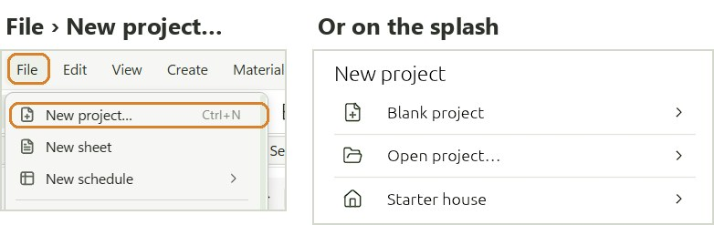
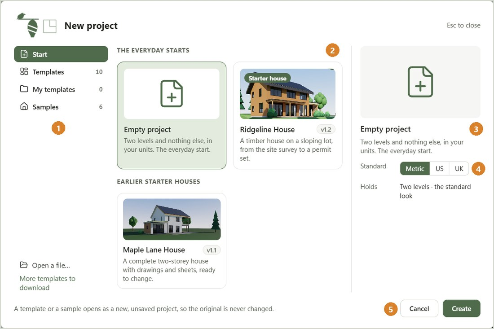
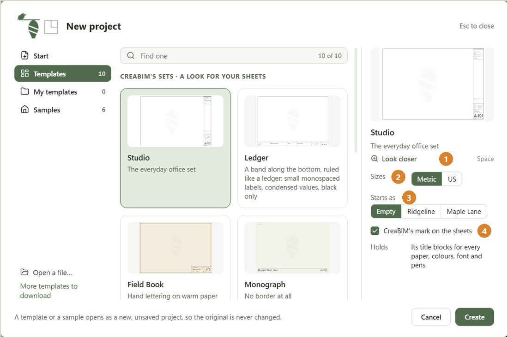
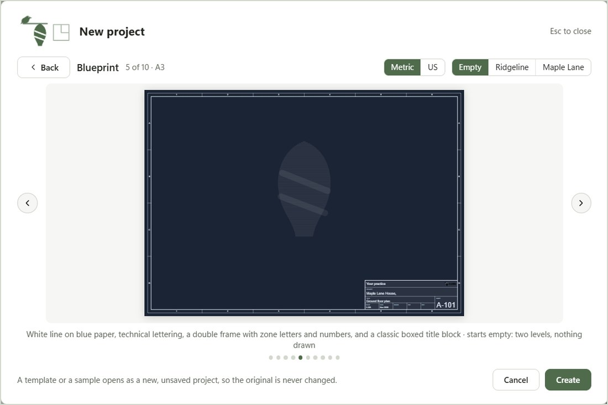
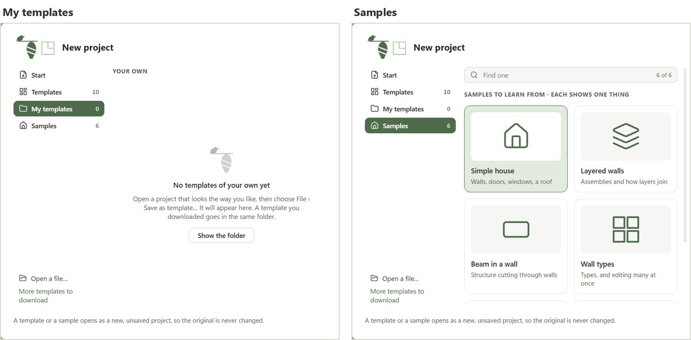
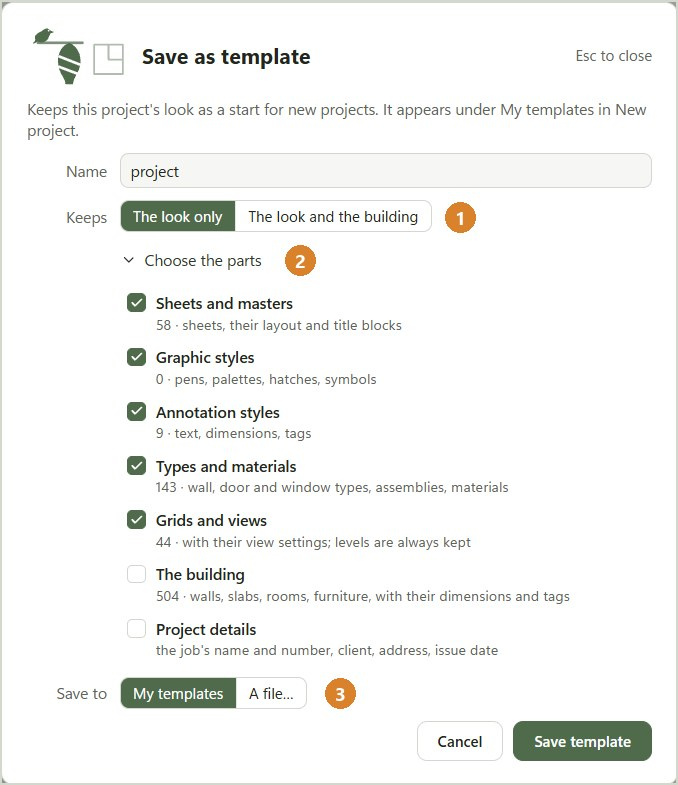
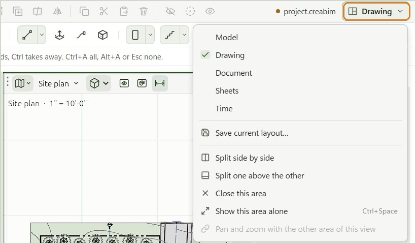

# Step 1: start a project

*File › New project…* (`Ctrl+N`) opens the **New project** window. The splash CreaBIM shows when it opens has the same starts.

## The New project window

1. **Sources**: *Start*, *Templates*, *My templates* and *Samples*. The number is how many each holds.
2. **Tiles**: click one to pick it.
3. **The one picked**: its picture, what it is and what it **Holds**.
4. Its choices. For an empty project, the **Standard**: *Metric*, *US* or *UK* sets its units and how its drawings look.
5. **Create** opens it as a new, unsaved project, so the original is never changed.

| Key | Does |
| --- | --- |
| `Arrow keys` | the next or the last tile |
| `Tab` | the next source (`Shift+Tab` the last) |
| `Space` | **Look closer** at the picked tile's picture |
| `Enter` | Create |
| `Esc` | close |

Down the left, **Open a file…** opens a project, and **More templates to download** opens CreaBIM's website.

## Start

| Tile | What you get |
| --- | --- |
| **Empty project** | Two levels and nothing else, in your units. The everyday start |
| **Ridgeline House** (*Starter house*, v1.2) | A timber house on a sloping lot, from the site survey to a permit set. CreaBIM opens on it the first time. See [The starter house](starter-house) |
| **Earlier starter houses** | The starter of each earlier version, its version on its tile. *Maple Lane House* came with 1.1 |

On the splash, **Blank project** starts an empty project at once, in the standard you work in.

## Templates

CreaBIM's ten **template sets** give a new project a look for its sheets: title blocks for every paper, colours, a font and pens. *Find one* searches them by name.

1. **Look closer** (`Space`) shows the sheet at the window's size (below).
2. **Sizes**: *Metric* or *US*, the project's units and paper sizes.
3. **Starts as**: *Empty*, or with a starter house in it, *Ridgeline* or *Maple Lane*.
4. **CreaBIM's mark on the sheets**: the mark, faint behind the drawings, and "Drawn in CreaBIM" in the title block. Untick to leave them off.

In **Look closer**, the arrows at its sides (or `←` `→`) step through the sets, and the choices are along the top. **Back** (or `Esc`) returns to the tiles.

| Set | Its look |
| --- | --- |
| **Studio** | The everyday office set: a strip down the right edge holds everything, one sage rule the only colour |
| **Ledger** | A band along the bottom, ruled like a ledger, black only. Dense and exact |
| **Field Book** | Hand lettering on warm paper, frame lines that run past their corners |
| **Monograph** | No border: one hairline and a very large sheet title, like a page of a book |
| **Blueprint** | White line on blue paper, a double frame with zone letters and numbers |
| **Workshop** | CreaBIM's own set: paper, sage, and the app's design lines at the corners |
| **Gallery** | The dark presentation set, for screens, projectors and exhibition boards |
| **Interior** | Warm paper, wide-spaced capitals, and finish samples in the title block |
| **Sketchbook** | Handwriting, a frame drawn twice as a pen would, soft colour washes |
| **Series** | A colour plate down the left edge; each drawing series has its own colour |

## My templates and Samples

- **My templates**: your own templates (below). **Show the folder** opens where they are kept.
- **Samples**: small projects made to learn from, each showing one thing.

| Sample | Shows |
| --- | --- |
| **Simple house** | Walls, doors, windows, a roof |
| **Layered walls** | Assemblies and how layers join |
| **Beam in a wall** | Structure cutting through walls |
| **Wall types** | Types, and editing many at once |
| **Furnished house** | Objects, fixtures and clearances |
| **House in its garden** | Terrain, paving and planting |

## Make your own template

Open a project that looks the way you like and choose *File › Save as template…*.

1. **Keeps**: *The look only*, or *The look and the building*.
2. **Choose the parts** opens the list, each with how many this project has: *Sheets and masters*, *Graphic styles*, *Annotation styles*, *Types and materials*, *Grids and views* (levels are always kept), *The building* and *Project details* (the job's name and number, client, address and issue date).
3. **Save to**: *My templates*, or *A file…* to send to someone.

**Save template** (or `Enter`) saves it. Templates are `.creabim-template` files in `Documents\CreaBIM\Templates`; one you were sent goes in the same folder.

**Apply a template's look…** (in the *File* menu) brings a template's graphic styles, annotation styles and masters into the project you have open, as one step that can be undone. Styles of the same name take the template's version, so everything using them follows; the others are added. Sheets, views, types and the building are not touched.

## Your units

Every field, dimension and schedule follows the project's units. To change them later, use *File › Project units…*: **Metric** (millimetres, centimetres or metres) or **Imperial** (feet and inches). See [Units](units).

## The views

The middle of the window is split into **areas**, each showing a view. Whatever you draw in one appears in the others at once. **Workspace**, at the top right, lays them out:

| Workspace | The areas |
| --- | --- |
| **Model** | One 3D area, for modelling |
| **Drawing** | The drawing open now beside the 3D view |
| **Document** | The 3D view, the drawing open now, and the sheet it is placed on |
| **Sheets** | A sheet beside the drawing being placed on it |
| **Time** | The drawing open now and the 3D view, over Project time and its Work log |

**Save current layout…** keeps the areas as you have them as a workspace of your own. Each area's header picks what it shows. See [View areas](interface#view-areas).

**Next:** [Set up the levels](start-levels)
